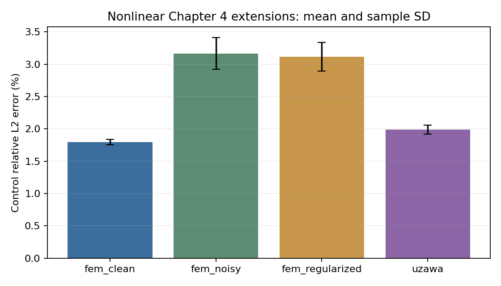

# Chapter 4: nonlinear representations and sparse observations v1

Four workflows, three seeds each. Deep Uzawa uses a trainable coordinate state network and an analytic control block; FEM-NN uses a trainable coordinate source network. All hidden layers are trained, and outputs are not restricted to the original 17-mode space.

Model selection uses train/val only. After all selections and sources were frozen, 512 new observation locations were generated for independent spatial/PDE checks. These are independent diagnostics for the same physical problem, not generalization tests on a new problem family.

| Workflow | Seeds | Control L2 error (%, mean +/- sample std) | Relative true-PDE gradient measure | Source L2 error (%) |
|---|---:|---:|---:|---:|
| fem_clean | 3 | 1.799 ± 0.04076 | 0.0551 | 8.595 |
| fem_noisy | 3 | 3.168 ± 0.2427 | 0.03695 | 17.32 |
| fem_regularized | 3 | 3.117 ± 0.2203 | 0.04059 | 13.42 |
| uzawa | 3 | 1.991 ± 0.06738 | 0.02333 | - |

Deep Uzawa uses grid-256 diagnostics and also retains grid-128 results; FEM-NN uses grid-128 diagnostics and also retains grid-64 results. Their discretizations and available information differ; no architecture ranking is claimed.

The three FEM-NN settings are sparse noiseless observations, sparse observations with 1% noise, and the same noisy data with H1/L2 regularization. Observation error alone does not establish correct source identification. Control objectives and gradients after a true-PDE solve are saved separately from learned-model objectives.

Completing the budget does not imply strict optimality. Nonlinear Uzawa uses finitely many inner iterations and cannot invoke convergence guarantees for exact convex inner solves. Controls are interpolated/extrapolated from the training grid; resolution transfer is not claimed. The original fixed-feature, pure-neural, and output-head-corrected results are retained.

Checkpoints support inference reload. The last checkpoint retains partial optimizer state for diagnostics, but the CLI does not promise exact training resumption. See training and assessment for selection histories, budgets, timings, and per-seed metrics.

