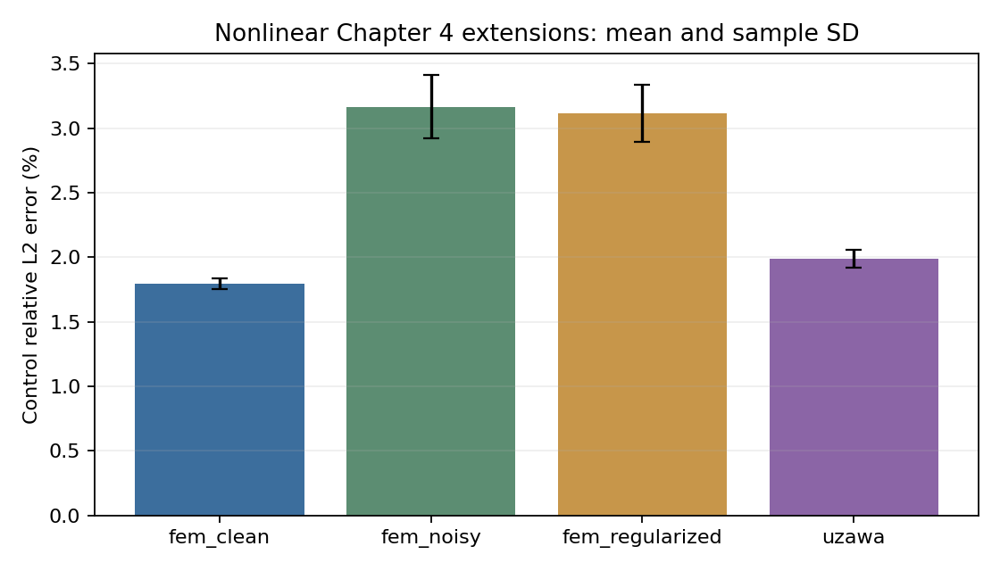

# 第四章非线性表示与稀疏观测深化 v1

四条流程、每条三个种子。Deep Uzawa使用可训练坐标状态网络和解析控制块；FEM-NN使用可训练坐标源项网络。所有隐藏层参与训练，输出不限制在原17模态空间。

模型选择只用train/val。全部选择与源码冻结后才生成512个新观测位置，并进行独立空间/PDE复核；这是同一物理问题的独立诊断，不是新问题族泛化测试。

| 流程 | 种子数 | 控制L2误差（%，均值 ± 样本标准差） | 真实PDE梯度相对量 | 源项L2误差（%） |
|---|---:|---:|---:|---:|
| fem_clean | 3 | 1.799 ± 0.04076 | 0.0551 | 8.595 |
| fem_noisy | 3 | 3.168 ± 0.2427 | 0.03695 | 17.32 |
| fem_regularized | 3 | 3.117 ± 0.2203 | 0.04059 | 13.42 |
| uzawa | 3 | 1.991 ± 0.06738 | 0.02333 | - |

Deep Uzawa采用256网格诊断，另保留128网格结果；FEM-NN采用128网格诊断，另保留64网格结果。两类流程的离散化与信息条件不同，不作架构排名。

FEM-NN三组分别为稀疏无噪声、稀疏1%噪声、同一噪声数据加H1/L2正则化；不能只凭观测误差认定源项被正确辨识。真实PDE重求后的控制目标和梯度与学习模型目标分别保存。

完成预算不等于满足严格最优性。非线性Uzawa内层采用有限迭代，不能援引精确凸内层的收敛保证。控制从训练网格插值/外推，不宣称分辨率迁移。原固定特征、纯神经和输出头修正结果继续保留。

本版本检查点支持推理重载；last保存部分优化器状态用于诊断，但CLI没有精确断点续训承诺。详细选模轨迹、预算、计时和逐种子指标见training与assessment。

