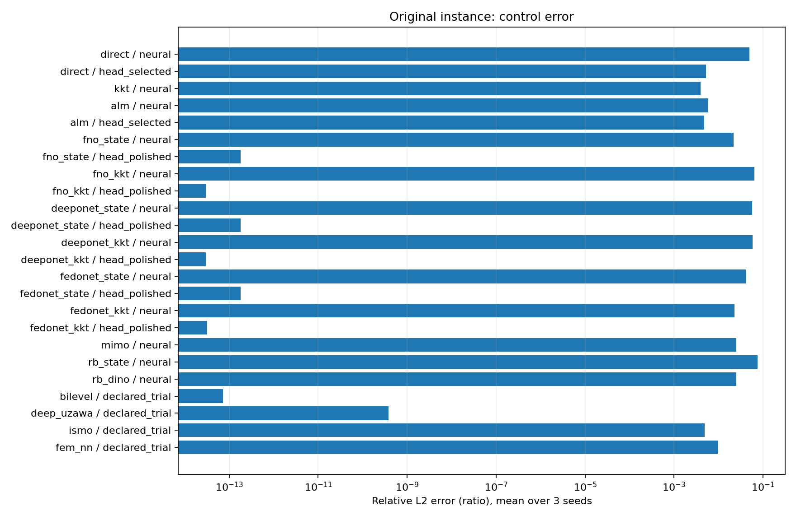
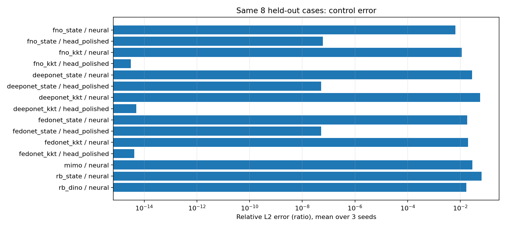

# Chapter 4: unified delivery v1

Completed 16 stochastic training workflows x 3 seeds, totaling 48 runs; the 9 reused seed0 runs retain provenance and byte hashes.
Pure-neural and output-head-corrected stages are reported separately, with 72 frozen checkpoint versions. Classical algorithms also undergo a 32/64/128/256-grid study.
A new 64-instance test set was generated only after all model selections were frozen. All 45 problem-family model versions underwent one formal evaluation; state surrogates perform online control on the same first 8 instances.
All 72 versions were additionally checked on the same original instance using order-96 Gauss quadrature and FEM grids 128/256.

Fixed sine features, training-only linear heads, and fully nonlinear networks are distinguished explicitly. A common delivery standard does not imply equal parameter counts or training costs, or an architecture ranking.
Bilevel, Deep Uzawa, and FEM-NN baselines retain the declared fixed sine features and trainable heads. Their three seeds test distinct initializations, not general deep nonconvex training.

## Same original instance: three-seed mean +/- sample standard deviation

| Method | Model stage | Control L2 error (%) | Worst seed (%) | FEM256 relative reduced-gradient norm |
|---|---|---:|---:|---:|
| direct | neural | 4.89 ± 3.33 | 8.718 | 0.05797 |
| direct | head_selected | 0.5193 ± 0.127 | 0.6328 | 0.006466 |
| kkt | neural | 0.3953 ± 0.293 | 0.7284 | 0.005854 |
| alm | neural | 0.5894 ± 0.298 | 0.9276 | 0.007525 |
| alm | head_selected | 0.4709 ± 0.208 | 0.6756 | 0.006067 |
| fno_state | neural | 2.174 ± 0.904 | 3.079 | 0.06277 |
| fno_state | head_polished | 1.793e-11 ± 6.01e-12 | 2.485e-11 | 0.003808 |
| fno_kkt | neural | 6.377 ± 4.59 | 9.993 | 0.2184 |
| fno_kkt | head_polished | 3.008e-12 ± 1.43e-12 | 4.592e-12 | 0.003808 |
| deeponet_state | neural | 5.71 ± 0.5 | 6.044 | 0.09386 |
| deeponet_state | head_polished | 1.816e-11 ± 3.45e-12 | 2.182e-11 | 0.003808 |
| deeponet_kkt | neural | 5.844 ± 1.67 | 7.476 | 0.09727 |
| deeponet_kkt | head_polished | 3.002e-12 ± 2.82e-13 | 3.255e-12 | 0.003808 |
| fedonet_state | neural | 4.157 ± 0.123 | 4.272 | 0.05364 |
| fedonet_state | head_polished | 1.821e-11 ± 1.13e-12 | 1.89e-11 | 0.003808 |
| fedonet_kkt | neural | 2.269 ± 0.398 | 2.587 | 0.02829 |
| fedonet_kkt | head_polished | 3.181e-12 ± 6.01e-13 | 3.848e-12 | 0.003808 |
| mimo | neural | 2.489 ± 0.553 | 3.109 | 0.04251 |
| rb_state | neural | 7.538 ± 4.55 | 12.69 | 0.1104 |
| rb_dino | neural | 2.531 ± 1.13 | 3.662 | 0.05675 |
| bilevel | declared_trial | 7.282e-12 ± 2.66e-17 | 7.282e-12 | 0.003808 |
| deep_uzawa | declared_trial | 3.85e-08 ± 8.08e-15 | 3.85e-08 | 0.003808 |
| ismo | declared_trial | 0.4846 ± 0.192 | 0.6532 | 0.007563 |
| fem_nn | declared_trial | 0.9614 ± 5.42e-07 | 0.9614 | 0.009318 |

FEM gradients include discretization error; models close to the exact spectral solution can still have nonzero FEM diagnostics. Objective differences against the P1 reference retain their signs across different control trial spaces and do not establish superiority to the continuous optimum.

## New held-out problems: control comparison on the same 8 instances

| Method | Model stage | Control L2 error (%, three-seed mean +/- std) |
|---|---|---:|
| fno_state | neural | 0.6436 ± 0.0641 |
| fno_state | head_polished | 6.073e-06 ± 1.55e-06 |
| fno_kkt | neural | 1.121 ± 0.116 |
| fno_kkt | head_polished | 3.129e-13 ± 7.84e-14 |
| deeponet_state | neural | 2.773 ± 0.135 |
| deeponet_state | head_polished | 5.179e-06 ± 1.37e-13 |
| deeponet_kkt | neural | 5.686 ± 0.444 |
| deeponet_kkt | head_polished | 5.048e-13 ± 7.63e-14 |
| fedonet_state | neural | 1.798 ± 0.0872 |
| fedonet_state | head_polished | 5.179e-06 ± 3.75e-14 |
| fedonet_kkt | neural | 1.968 ± 0.148 |
| fedonet_kkt | head_polished | 4.219e-13 ± 8.68e-14 |
| mimo | neural | 2.875 ± 0.468 |
| rb_state | neural | 6.377 ± 0.546 |
| rb_dino | neural | 1.675 ± 0.211 |

See assessment for state/direct-control metrics over all 64 cases, per-sample objectives and gradients, and online iteration trajectories. The table above uses exactly the same 8 cases.

## Delivery and limitations

- Configurations/budgets/histories/checkpoints: training/; frozen selection and source identity: SELECTION_FROZEN.json.
- New test set and nonoverlap evidence: heldout/; independent predictions and physical metrics: assessment/; audit: DELIVERY_AUDIT.json.
- Unified entry point: chapters/ch04_delivery/cli.py; both from-scratch training and explicit seed0 reuse are supported.
- DELIVERY_COMPLETE means the required training, evaluation, and audit are complete, not that every method reaches the same accuracy or strict optimality.
- Previous models, data, results, and frozen sources are retained; semilinear/parabolic extensions remain deferred.

