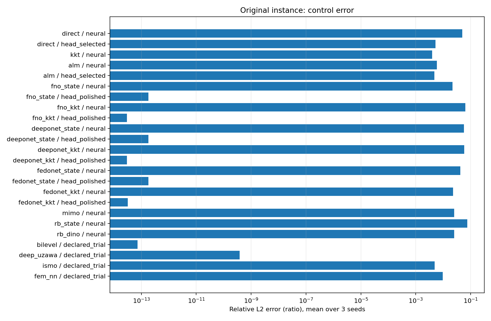
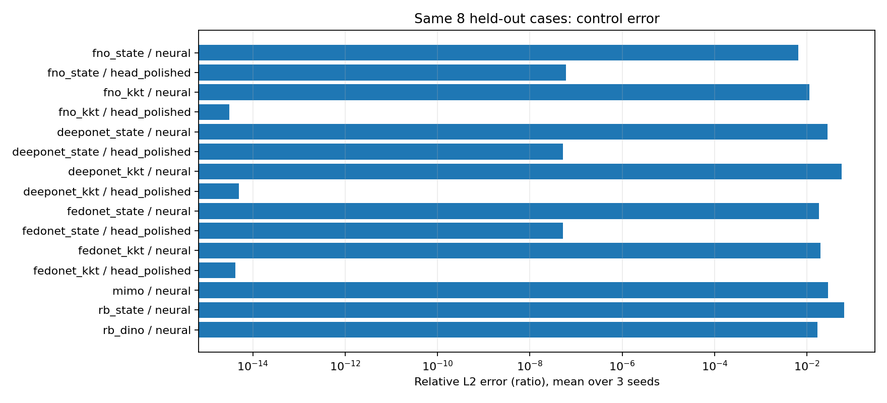

# 第四章统一交付 v1

已完成16类随机训练流程 × 3个种子，共48组训练交付；复用的9组seed0结果保留来源与字节哈希。
纯神经/输出头修正等阶段分开，共72个冻结检查点版本。经典算法另做32/64/128/256网格研究。
所有选模冻结后才生成新的64例test，45个问题族模型版本完成一次正式评测；状态代理在相同前8例上做在线控制。
全部72个版本另在同一原始算例、96阶Gauss积分和128/256网格FEM上复核。

固定正弦特征、训练集线性头、完整非线性网络均明确区分。这是相同交付标准，不是等参数量/等训练代价的架构排名。
双层、Deep Uzawa、FEM–NN仍采用已声明的固定正弦特征与可训练头；其三种子检验实际不同初始化，不代表一般深层非凸训练。

## 同一原始算例：3种子平均 ± 样本标准差

| 方法 | 模型阶段 | 控制L2误差（%） | 最差种子（%） | FEM256约化梯度相对范数 |
|---|---|---:|---:|---:|
| direct | neural | 4.89 ± 3.33 | 8.718 | 0.05797 |
| direct | head_selected | 0.5193 ± 0.127 | 0.6328 | 0.006466 |
| kkt | neural | 0.3953 ± 0.293 | 0.7284 | 0.005854 |
| alm | neural | 0.5894 ± 0.298 | 0.9276 | 0.007525 |
| alm | head_selected | 0.4709 ± 0.208 | 0.6756 | 0.006067 |
| fno_state | neural | 2.174 ± 0.904 | 3.079 | 0.06277 |
| fno_state | head_polished | 1.793e-11 ± 6.01e-12 | 2.485e-11 | 0.003808 |
| fno_kkt | neural | 6.377 ± 4.59 | 9.993 | 0.2184 |
| fno_kkt | head_polished | 3.008e-12 ± 1.43e-12 | 4.592e-12 | 0.003808 |
| deeponet_state | neural | 5.71 ± 0.5 | 6.044 | 0.09386 |
| deeponet_state | head_polished | 1.816e-11 ± 3.45e-12 | 2.182e-11 | 0.003808 |
| deeponet_kkt | neural | 5.844 ± 1.67 | 7.476 | 0.09727 |
| deeponet_kkt | head_polished | 3.002e-12 ± 2.82e-13 | 3.255e-12 | 0.003808 |
| fedonet_state | neural | 4.157 ± 0.123 | 4.272 | 0.05364 |
| fedonet_state | head_polished | 1.821e-11 ± 1.13e-12 | 1.89e-11 | 0.003808 |
| fedonet_kkt | neural | 2.269 ± 0.398 | 2.587 | 0.02829 |
| fedonet_kkt | head_polished | 3.181e-12 ± 6.01e-13 | 3.848e-12 | 0.003808 |
| mimo | neural | 2.489 ± 0.553 | 3.109 | 0.04251 |
| rb_state | neural | 7.538 ± 4.55 | 12.69 | 0.1104 |
| rb_dino | neural | 2.531 ± 1.13 | 3.662 | 0.05675 |
| bilevel | declared_trial | 7.282e-12 ± 2.66e-17 | 7.282e-12 | 0.003808 |
| deep_uzawa | declared_trial | 3.85e-08 ± 8.08e-15 | 3.85e-08 | 0.003808 |
| ismo | declared_trial | 0.4846 ± 0.192 | 0.6532 | 0.007563 |
| fem_nn | declared_trial | 0.9614 ± 5.42e-07 | 0.9614 | 0.009318 |

FEM梯度含离散误差，接近精确谱解的模型仍可能有非零FEM诊断值。不同控制试探空间对P1参考的目标差保留符号，不据此宣称优于连续最优解。

## 新留出问题：相同8例控制比较

| 方法 | 模型阶段 | 控制L2误差（%，3种子平均 ± 标准差） |
|---|---|---:|
| fno_state | neural | 0.6436 ± 0.0641 |
| fno_state | head_polished | 6.073e-06 ± 1.55e-06 |
| fno_kkt | neural | 1.121 ± 0.116 |
| fno_kkt | head_polished | 3.129e-13 ± 7.84e-14 |
| deeponet_state | neural | 2.773 ± 0.135 |
| deeponet_state | head_polished | 5.179e-06 ± 1.37e-13 |
| deeponet_kkt | neural | 5.686 ± 0.444 |
| deeponet_kkt | head_polished | 5.048e-13 ± 7.63e-14 |
| fedonet_state | neural | 1.798 ± 0.0872 |
| fedonet_state | head_polished | 5.179e-06 ± 3.75e-14 |
| fedonet_kkt | neural | 1.968 ± 0.148 |
| fedonet_kkt | head_polished | 4.219e-13 ± 8.68e-14 |
| mimo | neural | 2.875 ± 0.468 |
| rb_state | neural | 6.377 ± 0.546 |
| rb_dino | neural | 1.675 ± 0.211 |

完整64例状态/直接控制指标、各样本目标值和梯度、在线迭代轨迹见assessment；上表严格使用同一8例。

## 交付与边界

- 配置/预算/历史曲线/检查点：training/；选模锁定与源码身份：SELECTION_FROZEN.json。
- 新测试集及无重叠证据：heldout/；独立预测和物理指标：assessment/；复核：DELIVERY_AUDIT.json。
- 统一入口：chapters/ch04_delivery/cli.py；从零训练和显式复用seed0均受支持。
- DELIVERY_COMPLETE表示规定训练、评测、审计齐全，不表示每个方法都达到同一精度或严格最优性。
- 旧模型、数据、结果及冻结源码继续保留；半线性/抛物型扩展后置。

