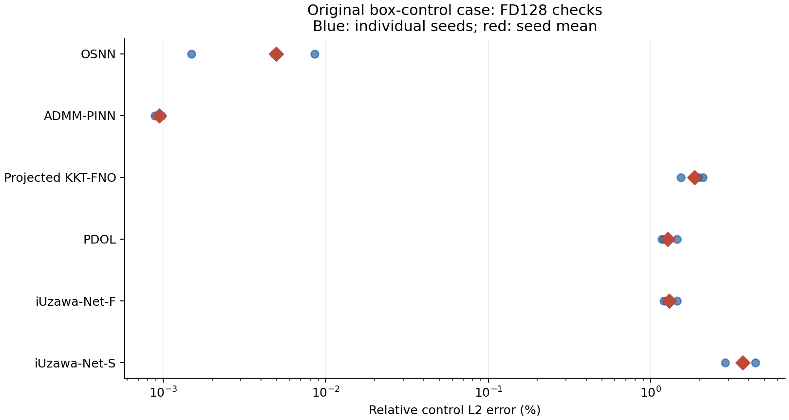
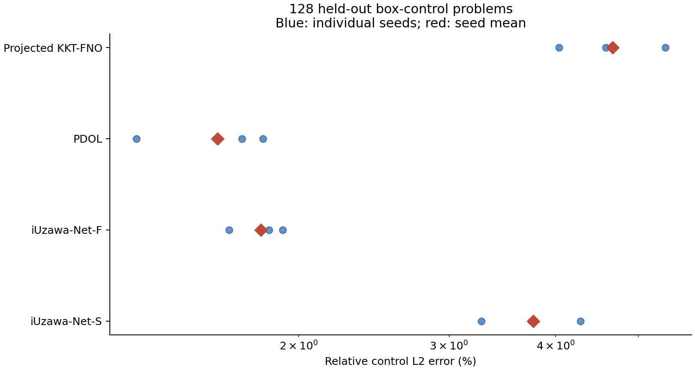
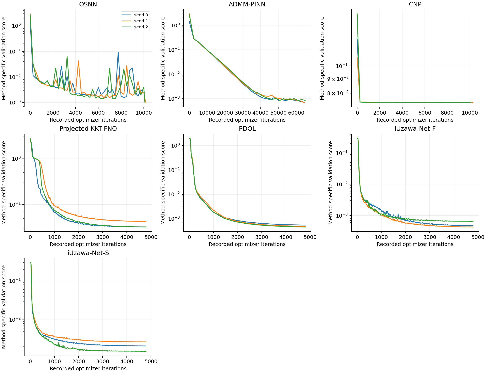
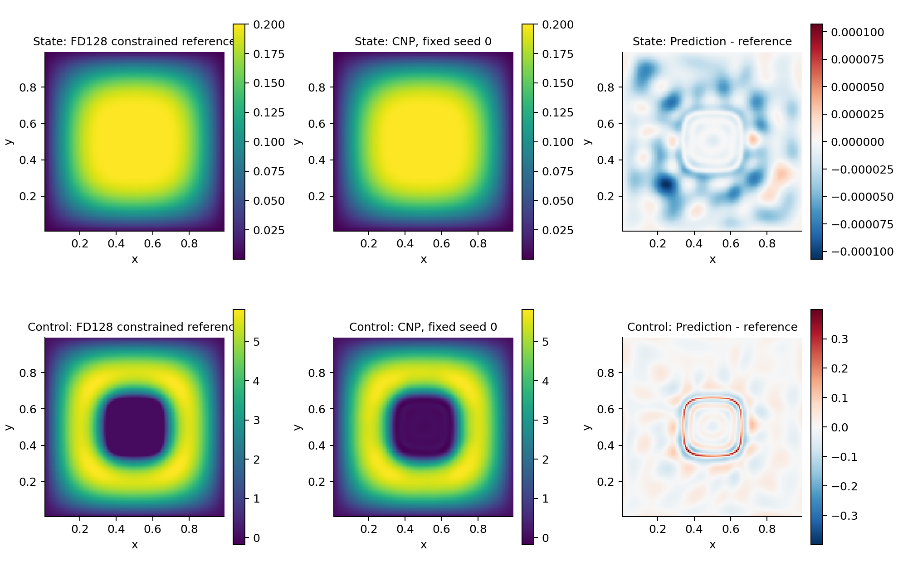
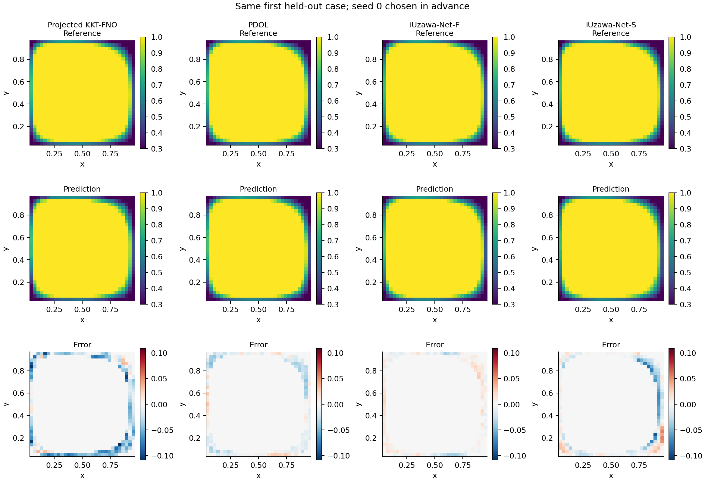

# 第五章统一交付 v1

7条迁移流程 × seed0/1/2，共21组正式训练和21个验证集选定模型。实例方法使用共同训练积分和验证点；问题族使用同一train1024/val128。
全部选模和源码冻结后，才生成新128例test；12个问题族模型使用相同全部样本，并在相同前8例上检查64/128加密网格。
所有模型另做原始算例空间复核；OSNN、ADMM、CNP使用96阶Gauss、129点边界及32/64/128差分网格。CNP是独立状态约束问题，不与控制盒约束例横向排名。

## 固定控制约束算例：三个种子均值 ± 样本标准差

| 方法 | Gauss控制相对L2误差（%） | FD128点上对连续制造解控制误差（%） | FD128真实投影残差L2 |
|---|---:|---:|---:|
| OSNN | 0.0049146 ± 0.00352 | 0.0049455 ± 0.00353 | 5.3894e-05 ± 4.28e-05 |
| ADMM-PINN | 0.00093698 ± 4.93e-05 | 0.00094281 ± 4.98e-05 | 2.2835e-05 ± 1.43e-06 |
| Projected KKT-FNO | 固定网格算子，无连续网络Gauss值 | 1.8585 ± 0.291 | 0.015652 ± 0.00302 |
| PDOL | 固定网格算子，无连续网络Gauss值 | 1.2742 ± 0.15 | 0.011072 ± 0.0022 |
| iUzawa-Net-F | 固定网格算子，无连续网络Gauss值 | 1.3001 ± 0.132 | 0.0099755 ± 0.00105 |
| iUzawa-Net-S | 固定网格算子，无连续网络Gauss值 | 3.6732 ± 0.762 | 0.031687 ± 0.00712 |

算子在细网格上的控制由原网格作边缘延拓的双线性插值得到；这是交付控制的独立数值检查，不是网络分辨率迁移。

## 新留出128例：相同问题、独立真实PDE重求

| 方法 | 控制相对L2均值（%，三种子平均 ± 标准差） | 真实目标相对差均值（%） | 真实投影残差L2均值 | 活动集错分均值（%，tol=1e-3） |
|---|---:|---:|---:|---:|
| Projected KKT-FNO | 4.6641 ± 0.673 | 0.089598 ± 0.0172 | 0.038412 ± 0.00602 | 4.0607 ± 0.732 |
| PDOL | 1.6085 ± 0.279 | 0.011903 ± 0.00551 | 0.013344 ± 0.00331 | 1.2885 ± 0.237 |
| iUzawa-Net-F | 1.8071 ± 0.134 | 0.015111 ± 0.00288 | 0.013703 ± 0.00112 | 2.1286 ± 0.226 |
| iUzawa-Net-S | 3.7659 ± 0.502 | 0.063337 ± 0.019 | 0.029252 ± 0.00451 | 4.106 ± 0.825 |

## CNP状态上界算例

96阶独立积分目标：0.073962 ± 1.76e-07；FD128约束QP参考目标：0.07395772266。
96阶目标减去选模时80阶目标的差：1.5151e-10 ± 1.18e-10。
对FD128参考控制的相对L2误差：1.1473 ± 0.0928%；神经状态上界违反量：0 ± 0；真实PDE重求状态的违反量：0 ± 0。
不同积分/离散空间的目标差保留符号；参数化可行不等于原连续问题已最优。离散参考使用独立状态空间凸QP，其可行性、非负乘子、驻点与互补性均复核。

## 训练、评测与解释边界

- training/保存每组配置、初始/最佳/最后权重、完整选模历史和实际Adam/L-BFGS计数。ADMM另保存可重建任意点分裂变量的全部历史。
- pure projected KKT-FNO、PDOL、iUzawa F/S均保留其实际架构；本批没有训练后线性头求解或测试集拟合。mimo是历史入口名，不是原乘法MIMOONet的复刻。
- PDOL的代理固定点残差、真实PDE投影残差分开；raw p为A_theta(S_theta(u+f)-yd)的诊断重构，不是观测空间对偶d。学习作用的配对、线性性与JVP误差单列。
- iUzawa采用精确盒投影、固定物理尺度和半正定结构Q_B；非线性权重共享不提供真实伴随保证，经验诊断也不是收敛证明。
- 各方法表示、训练数据和工作量不同，计时分列，不作架构排名或端到端加速比。
- DELIVERY_COMPLETE表示预算、选模、独立评测和审计齐全，不代表所有模型满足同一精度或严格最优性。
- 本轮test已查看；以后使用它属于复测，不得据此调整本版本。旧章节、迁移版本和开发验证保留，5.3/5.4及其他方程扩展继续后置。

统一入口：chapters/ch05_delivery/cli.py。冻结证据：PRETEST_AUDIT.json、SELECTION_FROZEN.json、heldout/manifest.json、DELIVERY_AUDIT.json。

