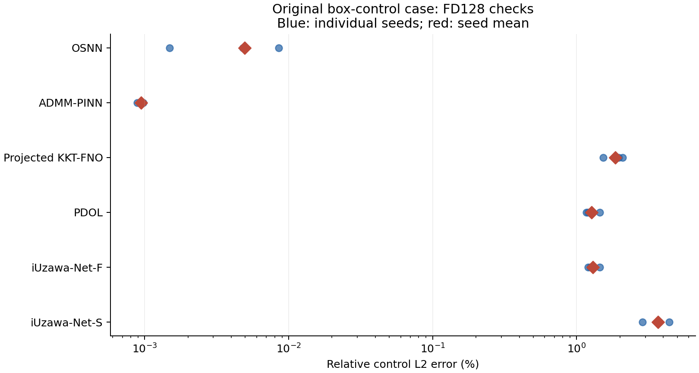
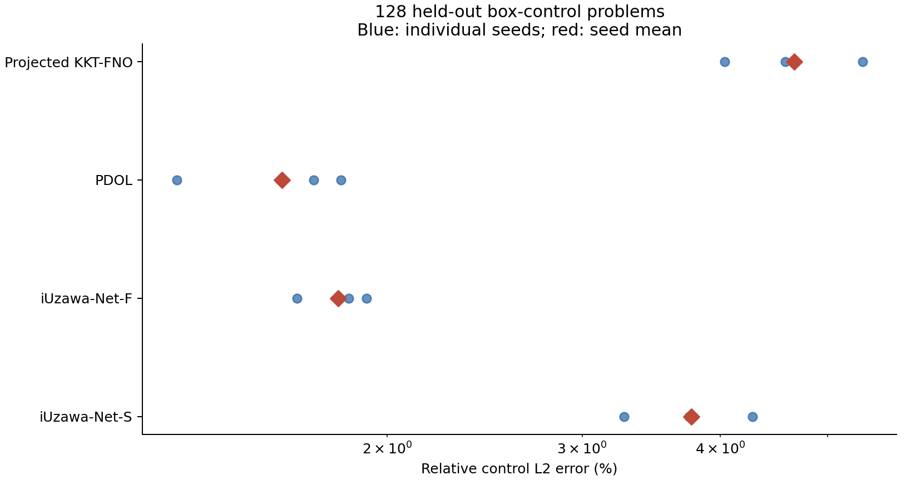
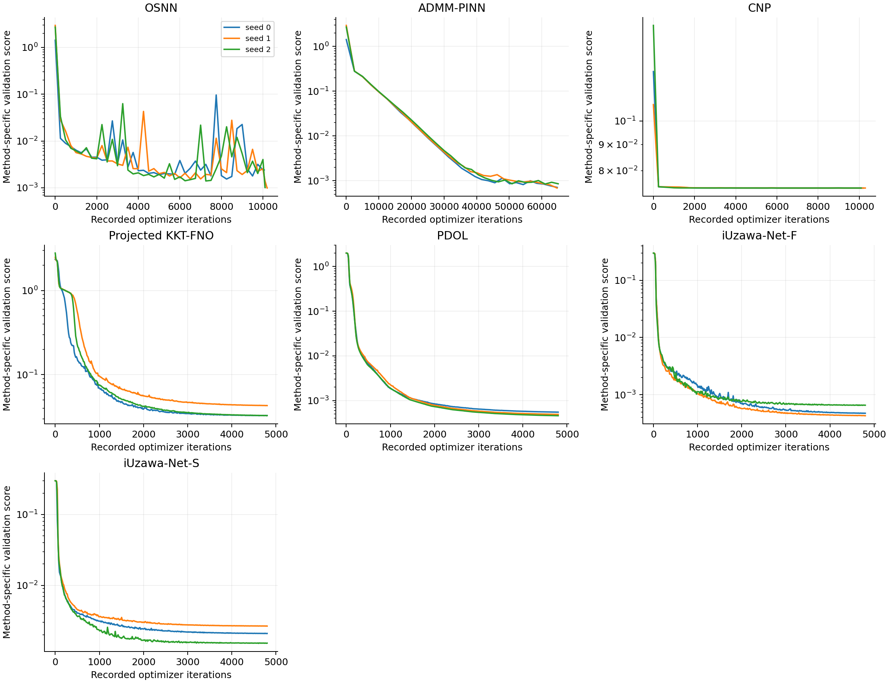
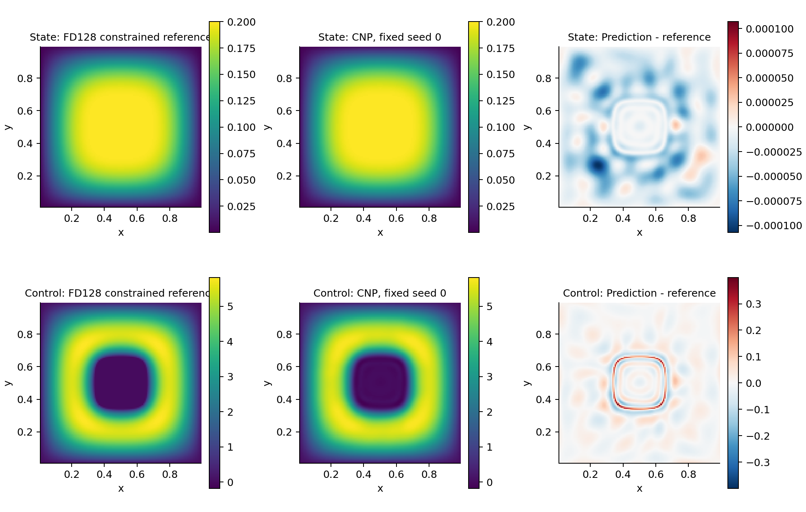
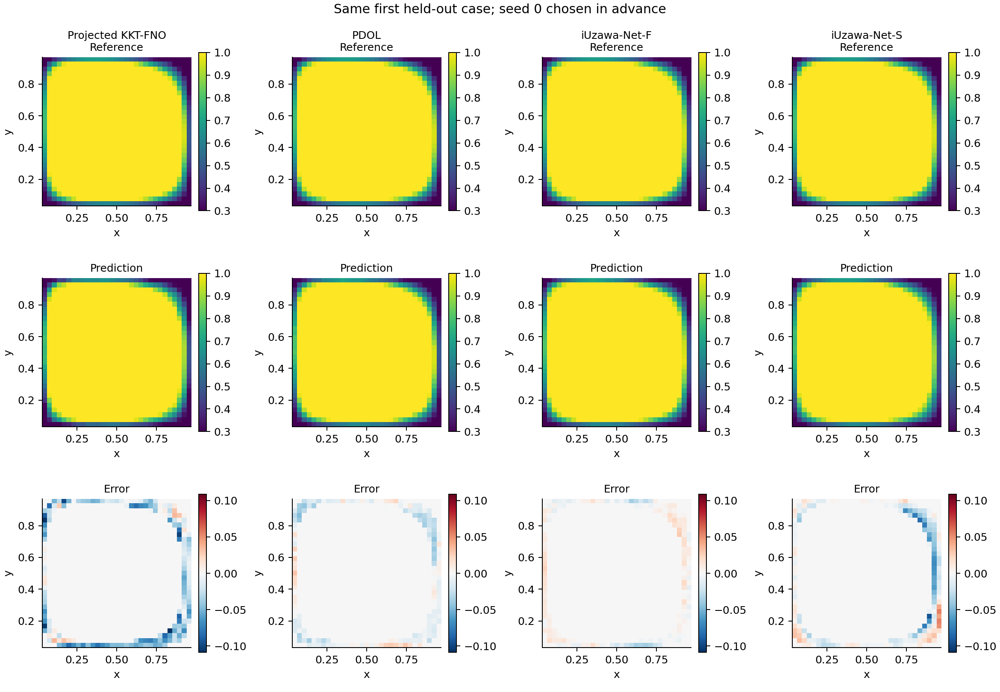

# Chapter 5: unified delivery v1

Seven ported workflows x seed0/1/2: 21 formal training runs and 21 validation-selected models. Instance methods share training quadrature and validation points; problem-family methods share train1024/val128.
A new 128-instance test set was generated only after model selection and sources were frozen. All 12 problem-family models use every test sample, with grid-64/128 refinement checks on the same first 8 cases.
All models also undergo spatial checks on the original instance. OSNN, ADMM, and CNP use order-96 Gauss quadrature, 129 boundary points, and finite-difference grids 32/64/128. CNP is a separate state-constrained problem and is not ranked against the box-constrained control example.

## Fixed control-constrained example: three-seed mean +/- sample standard deviation

| Method | Gauss relative control L2 error (%) | Control error against the continuous manufactured solution at FD128 points (%) | FD128 true projected-residual L2 |
|---|---:|---:|---:|
| OSNN | 0.0049146 ± 0.00352 | 0.0049455 ± 0.00353 | 5.3894e-05 ± 4.28e-05 |
| ADMM-PINN | 0.00093698 ± 4.93e-05 | 0.00094281 ± 4.98e-05 | 2.2835e-05 ± 1.43e-06 |
| Projected KKT-FNO | Fixed-grid operator; no continuous-network Gauss value | 1.8585 ± 0.291 | 0.015652 ± 0.00302 |
| PDOL | Fixed-grid operator; no continuous-network Gauss value | 1.2742 ± 0.15 | 0.011072 ± 0.0022 |
| iUzawa-Net-F | Fixed-grid operator; no continuous-network Gauss value | 1.3001 ± 0.132 | 0.0099755 ± 0.00105 |
| iUzawa-Net-S | Fixed-grid operator; no continuous-network Gauss value | 3.6732 ± 0.762 | 0.031687 ± 0.00712 |

Fine-grid controls for operators use bilinear interpolation with edge extension from the original grid. This independently checks the delivered control numerically; it is not network resolution transfer.

## New 128-instance holdout: shared problems and independent true-PDE solves

| Method | Mean relative control L2 (%, three-seed mean +/- std) | Mean relative true-objective difference (%) | Mean true projected-residual L2 | Mean active-set misclassification (%, tol=1e-3) |
|---|---:|---:|---:|---:|
| Projected KKT-FNO | 4.6641 ± 0.673 | 0.089598 ± 0.0172 | 0.038412 ± 0.00602 | 4.0607 ± 0.732 |
| PDOL | 1.6085 ± 0.279 | 0.011903 ± 0.00551 | 0.013344 ± 0.00331 | 1.2885 ± 0.237 |
| iUzawa-Net-F | 1.8071 ± 0.134 | 0.015111 ± 0.00288 | 0.013703 ± 0.00112 | 2.1286 ± 0.226 |
| iUzawa-Net-S | 3.7659 ± 0.502 | 0.063337 ± 0.019 | 0.029252 ± 0.00451 | 4.106 ± 0.825 |

## CNP state-upper-bound example

Order-96 independent-quadrature objective: 0.073962 ± 1.76e-07; FD128 constrained-QP reference objective: 0.07395772266.
Order-96 objective minus the order-80 objective used during selection: 1.5151e-10 ± 1.18e-10.
Relative L2 error against the FD128 reference control: 1.1473 ± 0.0928%; neural-state upper-bound violation: 0 ± 0; violation after a true-PDE state solve: 0 ± 0.
Objective differences between quadrature/discrete spaces retain their signs. Feasibility of the parameterization does not imply optimality for the original continuous problem. The discrete reference is an independent convex QP in state space; feasibility, nonnegative multipliers, stationarity, and complementarity are checked.

## Training, evaluation, and interpretation limits

- training/ stores configurations, initial/best/last weights, full selection histories, and actual Adam/L-BFGS counts. ADMM also saves complete histories for reconstructing split variables at arbitrary points.
- Pure projected KKT-FNO, PDOL, and iUzawa F/S retain their actual architectures. This batch uses no post-training linear-head solve or test-set fitting. mimo is a historical entry-point name, not a replication of the original multiplicative MIMOONet.
- PDOL surrogate fixed-point residuals and true-PDE projected residuals are separate. Raw p is the diagnostic reconstruction A_theta(S_theta(u+f)-yd), not the observation-space dual d. Pairing, linearity, and JVP errors of learned actions are reported separately.
- iUzawa uses exact box projection, fixed physical scaling, and the positive-semidefinite structure Q_B. Nonlinear weight sharing does not guarantee a true adjoint, and empirical diagnostics are not convergence proofs.
- Representations, training data, and workloads differ between methods. Timings are reported separately; no architecture ranking or end-to-end speedup is claimed.
- DELIVERY_COMPLETE means budgets, selection, independent evaluation, and audits are complete, not that all models meet one accuracy target or strict optimality.
- This test set has now been viewed; future use is a retest and must not guide changes to this version. Previous chapters, ports, and development validation are retained. Sections 5.3/5.4 and other equation extensions remain deferred.

Unified entry point: chapters/ch05_delivery/cli.py. Frozen evidence: PRETEST_AUDIT.json, SELECTION_FROZEN.json, heldout/manifest.json, DELIVERY_AUDIT.json.

